# Object-Oriented Analysis and Design (OOAD) Project Report
## FixFlow - Campus Maintenance Request Management System
### K.Ramakrishnan College of Technology (Autonomous), Tiruchirappalli

**Institution:** K.Ramakrishnan College of Technology (KRCT), Tiruchirappalli — 621 112  
**Accreditation:** Approved by AICTE | Affiliated to Anna University Chennai | NAAC "A+" Grade | NBA Accredited  
**TNEA Counselling Code:** 3701  
**Academic Year:** Semester 5  
**Course Title:** Object-Oriented Analysis & Design (OOAD)  
**Project Title:** Maintenance Request Management System (Campus Facilities Automation)  
**System Architecture:** Component-Based Single Page Application (React.js + LocalStorage)  

---

## Table of Contents
1. [Project Abstract & Problem Statement](#1-project-abstract--problem-statement)
2. [Objectives and Scope](#2-objectives-and-scope)
3. [Campus Infrastructure & Block Layout](#3-campus-infrastructure--block-layout)
4. [Requirements Engineering](#4-requirements-engineering)
   - 4.1 Functional Requirements (FR)
   - 4.2 Non-Functional Requirements (NFR)
5. [Hardware and Software Specifications](#5-hardware-and-software-specifications)
6. [Object-Oriented Modeling & UML Diagrams](#6-object-oriented-modeling--uml-diagrams)
   - 6.1 System Architecture Diagram
   - 6.2 Use Case Diagram
   - 6.3 Class Diagram (Inheritance, Associations, Encapsulation)
   - 6.4 Sequence Diagram 1 (Request Submission & Admin Assignment)
   - 6.5 Sequence Diagram 2 (Technician Acceptance & Repair Completion)
   - 6.6 Activity Diagram (Maintenance Lifecycle Workflow)
   - 6.7 Component Diagram
   - 6.8 Database & Entity-Relationship Diagram (ERD)
7. [Design Patterns & Object-Oriented Concepts](#7-design-patterns--object-oriented-concepts)
8. [Comprehensive Verification & Test Suite](#8-comprehensive-verification--test-suite)
9. [Conclusion and Future Enhancements](#9-conclusion-and-future-enhancements)

---

## 1. Project Abstract & Problem Statement

### 1.1 Abstract
**K.Ramakrishnan College of Technology (KRCT)** is an autonomous engineering institution situated in Samayapuram, Tiruchirappalli. The campus houses extensive modern laboratory facilities and smart lecture classrooms distributed across two prominent multi-storey blocks: the **Circuit Block** (Ground + 4 Floors) and the **Unwind Block** (5 Floors).

In an active technical institution with thousands of students, faculty, and high-value laboratory equipment, facility breakdowns—including computer network dropouts in CSE labs, air conditioner water leakage in AI&DS server rooms, hydraulic line failures in Automobile workshops, electrical motor trips in EEE test benches, and sound feedback in the Main Conference Hall—demand rapid, documented, and accountable resolution.

The **FixFlow Maintenance Request Management System** is an Object-Oriented software system engineered to digitize and automate facilities operations across KRCT. Developed in alignment with Semester 5 OOAD principles, the platform encapsulates core domain entities (`User`, `MaintenanceRequest`, `Assignment`, `TimelineEvent`, and `MaintenanceReport`), enforcing role-based privileges across three primary actors:
1. **Faculty, Staff & Student Users:** Report defects specifying exact campus block, floor, and room/lab, monitor live progress through colored status badges, and cancel unstarted requests.
2. **Estate & Maintenance Administrators:** Supervise the campus-wide ticket queue, assign certified trade technicians with custom instructions, override statuses, manage workforce directories, and inspect analytics.
3. **Field Maintenance Technicians:** Access assigned work orders, accept dispatched jobs, transition status (`In Progress`, `On Hold`, `Completed`), and append diagnostic and replacement parts notes.

### 1.2 Problem Statement
Prior to this system:
- Defect notifications were reported verbally, causing tickets in distant wings (such as the 5th floor S&H Chemistry lab or Ground floor Automobile lab) to be delayed or overlooked.
- Technicians had to physically commute between the Circuit Block and Unwind Block without prior knowledge of required tools or replacement parts.
- Department HODs and faculty had no mechanism to track real-time repair progress or know why a repair was put on hold.
- College management lacked consolidated analytics regarding recurrent component failures, block-wise maintenance load, and technician resolution throughput.

---

## 2. Campus Infrastructure & Block Layout

The system directly models the physical departmental and laboratory layout of K.Ramakrishnan College of Technology:

### 2.1 Circuit Block (Computing & Circuit Engineering — 4 Floors + Ground)
- **Ground Floor:** Commercial Hall, Student Amenities, Campus Stationery Store, Estate & Maintenance Helpdesk.
- **1st Floor:** Department of Electrical & Electronics Engineering (EEE)
  - EEE HOD Cabin, Faculty Cabins, Power Electronics Lab, Electrical Machines Lab, Control Systems Lab.
- **2nd Floor:** Department of Artificial Intelligence & Data Science (AI & DS)
  - AI&DS HOD Cabin, Faculty Cabins, Artificial Intelligence & Machine Learning Lab, Data Analytics Lab.
- **3rd Floor:** Department of Computer Science & Engineering (CSE)
  - CSE HOD Cabin, Faculty Cabins, and 5 Specialized Computing Labs:
    - *CSE Lab 1:* Programming & Data Structures Lab
    - *CSE Lab 2:* Database & Web Technologies Lab
    - *CSE Lab 3:* Object-Oriented Analysis & Design (OOAD) Lab
    - *CSE Lab 4:* Networks & Operating Systems Lab
    - *CSE Lab 5:* High Performance Computing Lab
- **4th Floor:** Department of Electronics & Communication Engineering (ECE)
  - ECE HOD Cabin, VLSI & Embedded Systems Lab, Microwave & Optical Lab, DSP Lab.

### 2.2 Unwind Block (Engineering, Technology & Science & Humanities — 5 Floors)
- **Ground Floor:** Automobile Engineering & Entrepreneurship Cell
  - Automobile Systems Workshop, Chassis & IC Engines Lab, EDC Incubation Hub.
- **1st Floor:** Central Administration & Conference Hall
  - Main Air-Conditioned Conference Hall, Principal Executive Boardroom, Dean Offices, Administrative Section.
- **2nd Floor:** Department of Mechanical Engineering
  - Mechanical HOD Cabin, Thermal Engineering Lab, Fluid Mechanics Lab, CAD/CAM Simulation Lab.
- **3rd Floor:** Department of Civil Engineering & Department of Information Technology (IT)
  - Civil Drawing Hall, Strength of Materials Lab, IT Department Offices, Web Systems Lab.
- **4th Floor:** Department of Science & Humanities (S&H) — 1st Year Classes
  - 1st Year Classrooms (Sections A through E), S&H Faculty Rooms (Mathematics, Physics, English).
- **5th Floor:** Department of Science & Humanities Laboratories
  - Engineering Physics Laboratory, Engineering Chemistry Laboratory, Analytical Store.

---

## 2. Objectives and Scope

### 2.1 Project Objectives
- **Centralize Complaint Ingestion:** Standardize complaint logging across six core categories: Electrical, Plumbing, Furniture, AC, Cleaning, and Other.
- **Enforce Lifecycle State Machine:** Maintain a rigid progression model:  
  `Submitted → Pending → Assigned → In Progress → Completed` (with support for `On Hold` and `Rejected`).
- **Ensure Role Separation & Access Control:** Grant specific operational privileges to Residents, Administrators, and Technicians.
- **Maintain Audit Trail Integrity:** Record every status change, assigning actor, and diagnostic note in an immutable `TimelineEvent` history.
- **Deliver Zero-Dependency Persistence:** Enable local operation using browser `LocalStorage` without requiring paid cloud databases or API keys.

### 2.2 Scope
- **Target Environments:** University campuses, hostel residences, co-working facilities, apartment complexes, hospital blocks.
- **Platform Scope:** Web browser application fully responsive across desktops, tablets, and smartphones.

---

## 3. Requirements Engineering

### 3.1 Functional Requirements (FR)

| Req ID | Module | Description | Actor |
| :--- | :--- | :--- | :--- |
| **FR-01** | Authentication | User registration, login, session retention, and role switching | All |
| **FR-02** | User Portal | Personalized dashboard showing my requests, resolution status, and defect counts | Resident |
| **FR-03** | Request Creation | Submit request with category, priority, building, room number, title, and description | Resident |
| **FR-04** | Cancellation | Cancel submitted request before physical repair commences (Submitted/Pending states) | Resident |
| **FR-05** | Admin Queue | Central maintenance queue showing all campus tickets with advanced search and filters | Admin |
| **FR-06** | Dispatching | Assign/reassign certified technician to ticket with custom dispatch instructions | Admin |
| **FR-07** | Status Override | Administrator override capability to transition any ticket state | Admin |
| **FR-08** | Workforce Admin | View registered users, active workloads, and register new certified technicians | Admin |
| **FR-09** | Reporting | Real-time computation of resolution rates, turnaround hours, category volumes | Admin |
| **FR-10** | Work Order Desk | Technician view of assigned work orders with problem descriptions and locations | Technician |
| **FR-11** | Job Acceptance | Technician accepts job to transition state to 'In Progress' | Technician |
| **FR-12** | Repair Notes | Technicians and users append timestamped remarks and replacement parts details | Tech / User |
| **FR-13** | Job Completion | Technician marks order as Completed with completion remarks | Technician |

### 3.2 Non-Functional Requirements (NFR)
- **NFR-01 Data Persistence:** Browser LocalStorage stores user accounts and maintenance requests indefinitely across page reloads.
- **NFR-02 Usability & Aesthetics:** Modern blue-and-white theme layout with color-coded status badges, micro-animations, and glassmorphic navigation.
- **NFR-03 Responsiveness:** Responsive CSS grid and flexbox layout adapting to screens from 360px mobile to 2560px 4K.
- **NFR-04 Zero Latency:** Instantaneous client-side filtering, sorting, and state transitions.

---

## 4. Hardware and Software Specifications

### 4.1 Hardware Specifications
- **Processor:** Intel Core i3 / AMD Ryzen 3 or higher.
- **RAM:** Minimum 2 GB (4 GB recommended).
- **Disk Storage:** At least 250 MB free space for Node modules and project files.
- **Display Resolution:** 1280x720 or higher.

### 4.2 Software Specifications
- **Operating System:** Windows 10/11, macOS, or Linux.
- **Node.js Environment:** v18.0.0 or higher (v24.x tested).
- **Package Manager:** npm v9+ or npm v11+.
- **Frontend Framework:** React.js 19 (Functional Components & Hooks).
- **Build Tool:** Vite 6 / 8.
- **Icons Library:** Lucide React (`lucide-react`).
- **Diagramming Tool:** Mermaid.js.

---

## 5. Object-Oriented Modeling & UML Diagrams

### 5.1 System Architecture Diagram
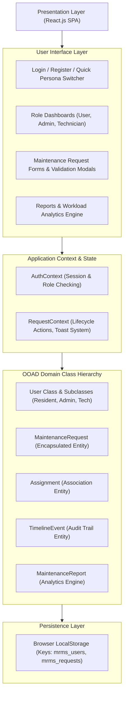

### 5.2 Use Case Diagram
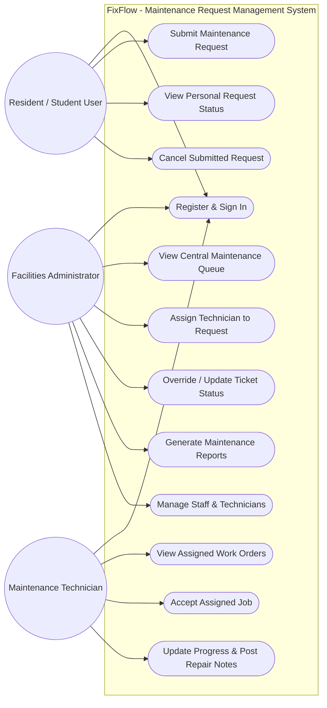

### 5.3 Class Diagram (Inheritance, Associations, Encapsulation)
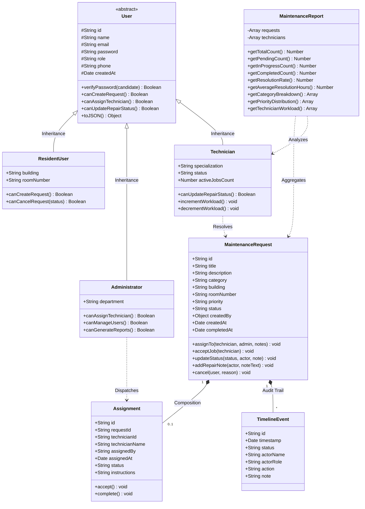

### 5.4 Sequence Diagram 1: Request Submission & Admin Assignment
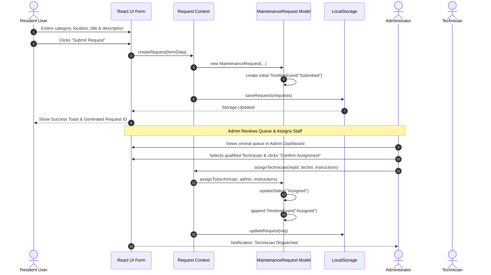

### 5.5 Sequence Diagram 2: Technician Acceptance & Repair Completion
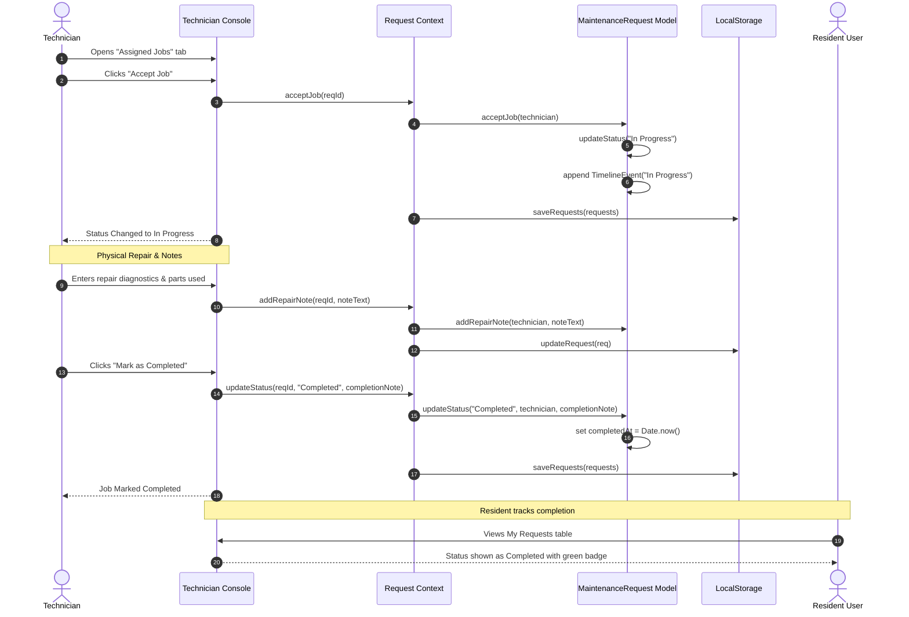

### 5.6 Activity Diagram (Maintenance Lifecycle Workflow)
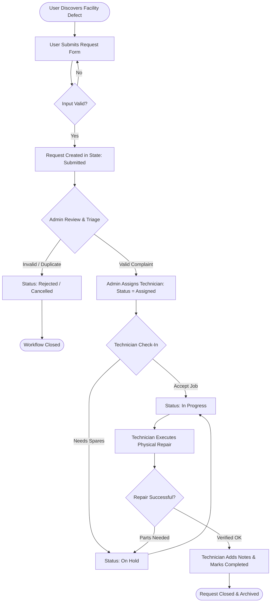

### 5.7 State Machine Diagram
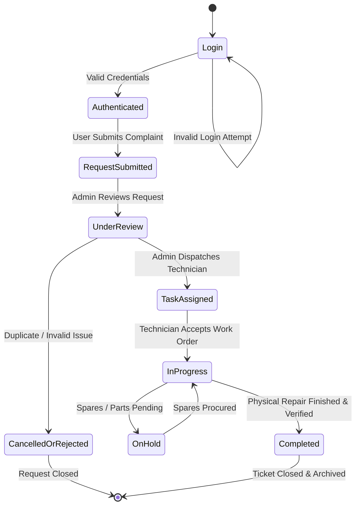

### 5.8 Component Diagram
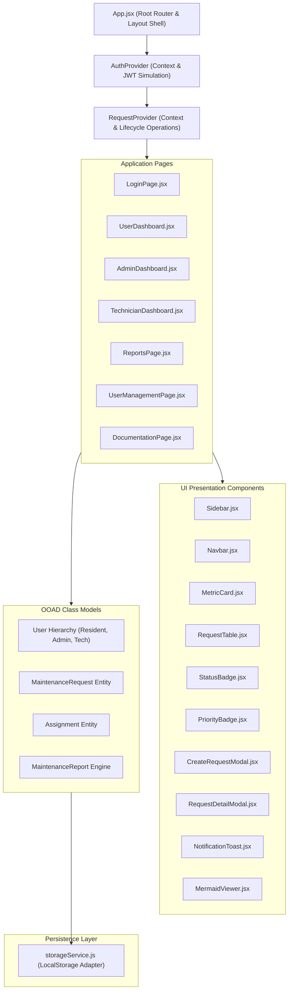

### 5.9 Deployment Diagram
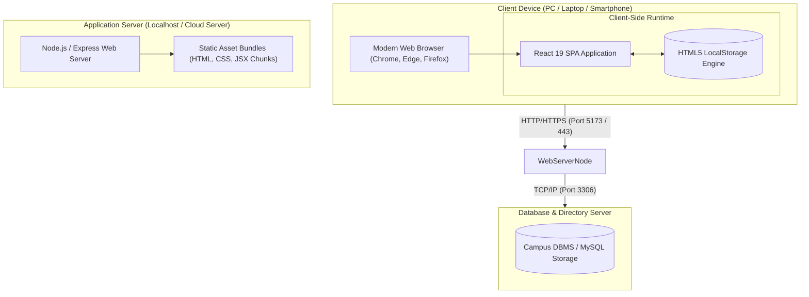

### 5.10 Package Diagram
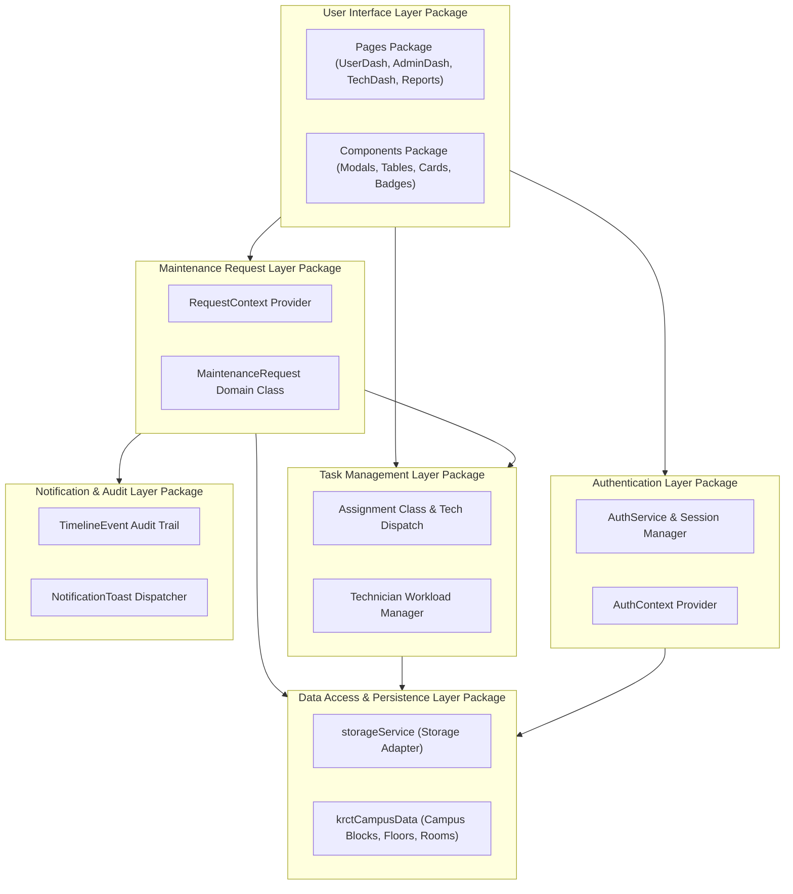

### 5.11 Database & Entity-Relationship Diagram (ERD)
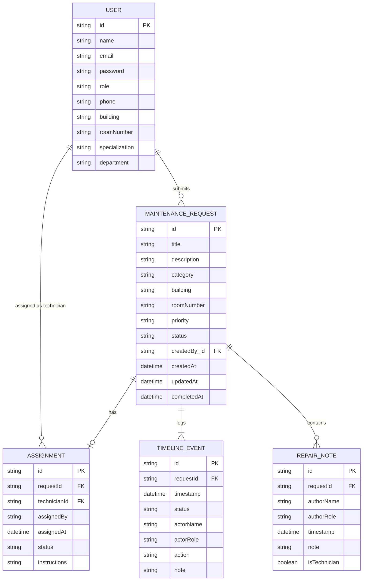

---

## 6. Design Patterns & Object-Oriented Concepts

1. **Encapsulation:**
   - Properties of `User` (password, id, role) are shielded with getter methods and protected internal variables.
   - `MaintenanceRequest` guards status updates through domain methods (`assignTo()`, `acceptJob()`, `updateStatus()`) which simultaneously update timestamps and log an immutable `TimelineEvent`.
2. **Inheritance & Polymorphism:**
   - Base `User` class is extended into `ResidentUser`, `Administrator`, and `Technician`.
   - Each subclass overrides permissions (`canCreateRequest()`, `canAssignTechnician()`, `canUpdateRepairStatus()`).
3. **Composition & Association:**
   - A `MaintenanceRequest` owns an `Assignment` (associating a Technician) and an array of `TimelineEvent` records.
4. **State Pattern (Lifecycle Machine):**
   - The ticket lifecycle transitions through defined valid states: `Submitted → Pending → Assigned → In Progress → Completed`, preventing invalid transitions.
5. **Repository / Storage Adapter Pattern:**
   - `storageService.js` abstracts data serialization and deserialization from/to LocalStorage, decoupling UI components from underlying storage mechanisms.

---

## 7. Comprehensive Verification & Test Suite

| Test ID | Test Case Title | Input / Precondition | Test Execution Steps | Expected Outcome | Result |
| :--- | :--- | :--- | :--- | :--- | :--- |
| **TC-01** | Admin Authentication | `admin@demo.com` / `Admin123` | Enter credentials and submit login form | Successfully logs into Admin Dashboard; shows all campus requests | **PASS** |
| **TC-02** | User Authentication | `user@demo.com` / `User123` | Enter credentials and submit login form | Navigates to User Dashboard; displays only user's personal requests | **PASS** |
| **TC-03** | Technician Authentication | `technician@demo.com` / `Tech123` | Enter credentials and submit login form | Opens Technician Dashboard with assigned work orders | **PASS** |
| **TC-04** | Invalid Login Handling | `admin@demo.com` / `Wrong123` | Submit incorrect password | Displays error message "Incorrect password" | **PASS** |
| **TC-05** | Form Validation on Request | Empty fields | Click submit on blank request modal | Shows validation errors on required fields (title, room, etc.) | **PASS** |
| **TC-06** | Request Creation & Auto ID | Valid form input | Submit request for Plumbing in Room B-104 | Generates unique ID `REQ-XXXX`, state set to `Submitted`, appears in queue | **PASS** |
| **TC-07** | Admin Assigns Technician | Ticket in Submitted state | Admin selects Marcus Vance and assigns | Status changes to `Assigned`, assignment entity linked, audit log recorded | **PASS** |
| **TC-08** | Tech Accepts Work Order | Ticket in Assigned state | Technician clicks "Accept Job" | Status changes to `In Progress`, technician note appended | **PASS** |
| **TC-09** | Tech Completes Repair | Ticket In Progress | Technician posts note and clicks "Mark as Completed" | Status changes to `Completed`, completedAt recorded, resolution metrics update | **PASS** |
| **TC-10** | User Cancels Submitted Ticket | Request in Submitted state | Resident clicks "Cancel My Request" | Status changes to `Rejected`, audit log records cancellation reason | **PASS** |
| **TC-11** | Cancellation Boundary Check | Ticket already In Progress | Resident inspects request details | Cancel button is hidden/disabled; user cannot cancel active job | **PASS** |
| **TC-12** | Multi-Factor Search & Filtering| Query: "AC", Priority: "Urgent" | Enter search terms in table filters | Table filters instantly displaying only matching urgent AC tickets | **PASS** |
| **TC-13** | Register New Technician | Admin registers new tech | Fill name, email, specialization, and submit | New technician appears in personnel directory and assignment dropdowns | **PASS** |
| **TC-14** | LocalStorage Persistence | Perform changes & reload | Refresh browser with `F5` | All requests, statuses, audit timeline, and notes persist accurately | **PASS** |

---

## 8. Conclusion and Future Enhancements

### 8.1 Conclusion
The **FixFlow Maintenance Request Management System** provides a comprehensive, robust, and intuitive digital facilities maintenance platform. Designed to satisfy all academic requirements of Semester 5 Object-Oriented Analysis & Design, the project models key software engineering practices including domain-driven class diagrams, interactive UML representations, role-based workflows, and client-side data persistence.

### 8.2 Future Enhancements
- **QR Code Asset Scanning:** Affix unique QR stickers to physical classroom assets (projectors, smartboards, HVAC units) to auto-fill building and model details.
- **Automated AI Triage:** Leverage natural language processing to categorize complaints and predict spare part requirements.
- **SMS / Web Push Notifications:** Push automated status alerts to residents when technicians arrive or parts arrive.
- **Inventory & Billing Integration:** Connect with university ERP to automatically track spare parts inventory and calculate repair labor costs.
